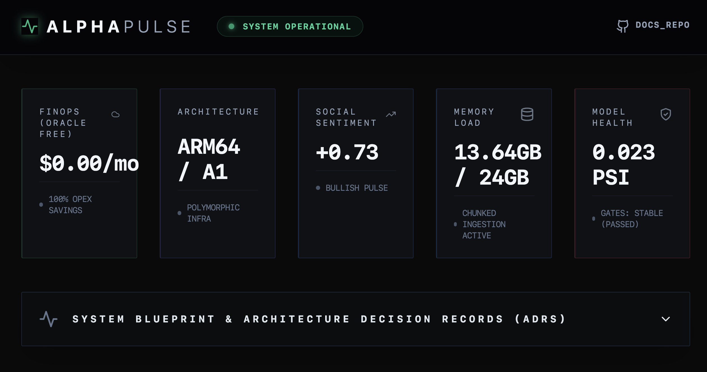
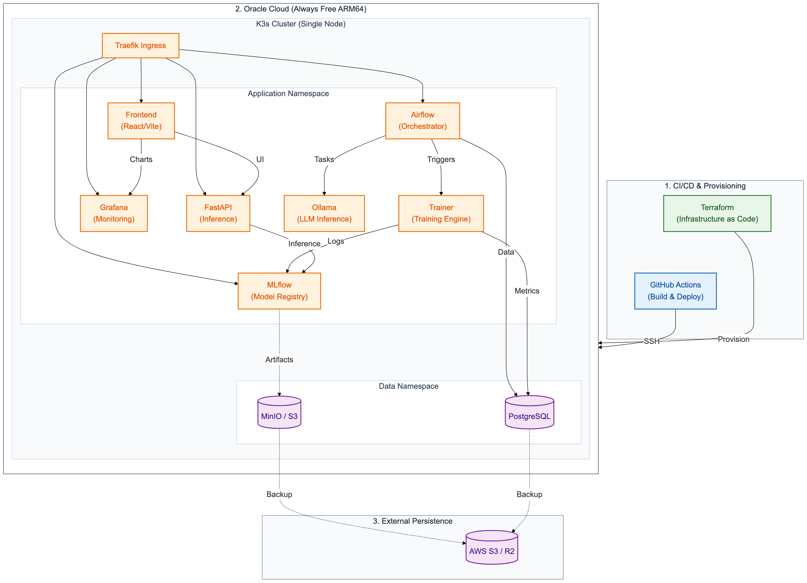

# AlphaPulse — Financial Data & Analytics Application

**Python · FastAPI · PostgreSQL · Data Pipelines · LLM Tool-Calling**

A personal software project, AlphaPulse brings together **REST APIs, financial data pipelines, and a multi-step LLM agent** in a Python backend project.

Built around cryptocurrency market data, it demonstrates **input validation, access control, relational data modeling, and background workflow orchestration**. A React dashboard provides the interface; a standalone Python/Ollama agent demonstrates bounded tool execution.

> **Project status:** Hosted services are currently offline. The standalone agent has recorded local verification on synthetic fixtures; full-platform validation remains incomplete.

[Portfolio](https://luichu.dev/) · [Demo URL (currently offline)](https://alphapulse.luichu.dev/)

[Architecture](#system-architecture) · [Engineering highlights](#engineering-highlights) · [Verification](#verified-agent--security-scope) · [Run locally](#run-locally-with-orbstack)

## At a Glance

| Engineering focus | What the project demonstrates |
| --- | --- |
| **Backend & API Engineering** | FastAPI services with structured request validation, JWT authentication, and permission checks for market-data access. |
| **Financial Data Processing** | PostgreSQL data models and scheduled workflows integrating market prices, technical indicators, and news sentiment. |
| **LLM Tool Integration** | A bounded Python/Ollama agent with dependent tool calls, validated arguments, execution limits, and recorded traces. |
| **Engineering Verification** | Automated protocol and security tests, documented design decisions, and reproducible agent evaluation records. |

**Explore:** [API routes](src/alphapulse/api/routes/) · [Data workflows](airflow/dags/) · [Agent walkthrough](docs/agents/README.md) · [Verification evidence](docs/agents/EVIDENCE.md) · [中文專案複習筆記](docs/PROJECT_REVIEW.zh-TW.md)

## Dashboard Preview



The React interface presents prices, signals, and workflow views. It includes demo data and fallback behavior; some operational API responses are also mocked. The screenshot illustrates the interface rather than current live-service health.

## System Architecture

The architecture separates **API services, background processing, model execution, and persistent storage** into distinct responsibilities. The diagram preserves the broader platform deployment design and history.



[Open scalable diagram](docs/images/system-architecture.svg) · [Mermaid source](docs/architecture/system-architecture.mmd)

**Diagram key:** Blue = CI/CD · Green = infrastructure · Orange = application services · Purple = storage. Solid arrows show service interactions; dotted arrows show artifact and backup flows.

**Architecture scope:** This is the platform deployment design, not a live-service status view. The locally verified agent is standalone and uses synthetic fixtures; it is not connected to the platform database, monitoring services, or dashboard.

## Engineering Highlights

### API Design & Access Control

The backend exposes market-data and application endpoints through **FastAPI**, with **Pydantic validation**, **SQLAlchemy models**, and explicit authorization boundaries on price, indicator, and signal routes.

The security changes validate JWT access tokens and active users, distinguish **read and write permissions**, and store API keys as digests. Key scopes are constrained by the owner's current permissions. Regression tests cover unauthorized access and privilege-escalation scenarios.

[API implementation](src/alphapulse/api/routes/) · [Authentication and authorization](src/alphapulse/security/auth.py) · [Security regression tests](tests/security/)

### Data Modeling & Financial Precision

PostgreSQL models organize market prices, indicators, and generated signals. **Numeric/Decimal types** are used in financial data models and cash/cost calculations in backtesting, while ML features and some statistical calculations use floating-point formats.

This provides a concrete setting for reasoning about **data contracts, numeric representation, and serialization** across database and application boundaries.

[Data models](src/alphapulse/api/models.py) · [API schemas](src/alphapulse/api/schemas/) · [Backtesting implementation](src/alphapulse/ml/backtest.py)

### Workflow Orchestration & Feature Processing

**Airflow DAGs** express dependencies between ingestion, feature integration, training, drift analysis, and inference. Shared feature processing produces return, volatility, volume, sentiment, and time-based inputs, with a materialized **feature_store** table used across the modeling workflow.

The repository also includes time-series validation, model comparison, MLflow experiment recording, and Champion/Challenger inference code. These components provide context for discussing **workflow dependencies, training/serving consistency, and model lifecycle management**; the full pipeline was not rerun as part of the isolated agent validation.

[Workflow orchestration](airflow/dags/full_production_dag.py) · [Feature producer](src/alphapulse/ml/features/feature_producer.py) · [Training](src/alphapulse/ml/training/iterative_trainer.py) · [Inference](src/alphapulse/ml/inference/engine.py)

### LLM Tool-Calling & Execution Boundaries

The monitoring PoC implements a **multi-step tool-calling loop** using Python and Ollama's native chat protocol:

```text
Model → get_snapshot(symbol) → synthetic metrics + snapshot ID
Model → evaluate_snapshot(returned ID) → deterministic threshold checks
Model → final summary
```

The model selects tools from schemas. Python enforces an **allowlist, strict arguments, prior-turn data dependencies, and execution budgets**. Numerical checks run in code; the model interprets the tool results. The task and available tools are deliberately constrained.

Transport is restricted to local loopback HTTP, with redirects and proxies disabled. Explicitly saved traces use private file permissions and cannot overwrite existing artifacts. The agent has no trading, shell, arbitrary URL, or database-write tools.

[Agent implementation](src/alphapulse/agents/) · [Protocol tests](tests/agent_poc/) · [Recorded hardened runs](examples/agent/live/hardened/)

### Deployment & Operational Tradeoffs

**Docker Compose**, **Terraform**, and **k3s manifests** document service separation and deployment choices, including an OCI ARM64 environment. They provide a basis for discussing infrastructure as code, resource constraints, and the maintenance tradeoffs of a single-node cluster.

Infrastructure configurations require further deployment and security validation. Historical cost and performance claims are not presented as current benchmarks.

[Local service definitions](infra/docker-compose.yml) · [Terraform](infra/terraform/) · [k3s manifests](infra/k3s/base/) · [Architecture decisions](docs/architecture/README.md)

## Verified Agent & Security Scope

| Verification | Recorded result |
| --- | --- |
| **Earlier offline regression snapshot** | **24 passed:** 13 agent protocol tests and 11 selected security regression tests. One opt-in live unittest is skipped by default. |
| **Initial live-model evaluation** | Six Ollama runs completed on synthetic BTC/ETH fixtures at source commit `2593bd6`. |
| **Hardened live-model evaluation** | Two Ollama runs completed on the same fixture scenarios at source commit `f06ef0a`. |
| **Dependency remediation** | Frontend npm audit: 35 → 0 known vulnerabilities; API/test installed-package audits: none found. [Scope and evidence](docs/local/SECURITY_REMEDIATION.zh-TW.md). |
| **Traceability** | Tool interactions, source revision, model digest, and Ollama version are recorded. Final summaries were manually checked against tool evaluations. |
| **Dedicated CI** | Agent protocol and security jobs passed for `f06ef0a`; [recorded run](https://github.com/ChuLiYu/alphapulse-mlops-platform/actions/runs/39167137031). |
| **OrbStack live agent** | Containerized qwen3:4b completed a cross-turn tool chain and a manually checked summary on a synthetic fixture; [recorded verification](docs/local/VERIFICATION.zh-TW.md). |
| **OrbStack core integration** | **36 passed, 1 opt-in live test skipped:** containerized agent/security tests plus PostgreSQL, authenticated API round-trip, frontend proxy and SPA checks. |

These results cover specific fixtures and security boundaries. Workflow completion does not automatically prove summary correctness or general model reliability. The broader platform workflow failed during dependency installation, before its tests ran; [recorded failure](https://github.com/ChuLiYu/alphapulse-mlops-platform/actions/runs/39167137015).

[Detailed evidence and limits](docs/agents/EVIDENCE.md) · [Security review and upgrade steps](docs/agents/SECURITY_REVIEW.md)

## Technology Stack

| Area | Technologies used in the project |
| --- | --- |
| **Backend** | Python, FastAPI, Pydantic, SQLAlchemy, JWT |
| **Data Engineering** | PostgreSQL, pandas, Apache Airflow, MinIO/S3-compatible storage configuration |
| **Testing & Automation** | unittest, pytest, GitHub Actions, Black |
| **Infrastructure** | Docker Compose, Terraform, Kubernetes/k3s, Traefik |
| **AI & Modeling** | Ollama native tool-calling, CatBoost, scikit-learn, MLflow |
| **Frontend** | React, TypeScript, Vite, Tailwind CSS, Recharts |

## Run Locally with OrbStack

The local workflow uses **one entry point**. Python/Node dependencies are installed inside container images; the host needs OrbStack, Docker Compose, and a shell.

```bash
./alphapulse setup   # Create private local settings and build images
./alphapulse up      # Start PostgreSQL, API, and frontend
./alphapulse test    # Run containerized regression and integration checks
./alphapulse audit   # Audit frontend lock and installed Python image packages
./alphapulse agent   # Start containerized Ollama and run model-driven tools
```

```bash
./alphapulse status
./alphapulse logs
./alphapulse down    # Stop services; keep database and model volumes
```

The core environment runs the existing API and React frontend against a local PostgreSQL service. The **standalone agent uses synthetic fixtures** and remains separate from the database and dashboard. Ollama runs inside OrbStack; its first run downloads the selected model into a project volume. Container CPU inference can be slower than native macOS inference.

[Local setup and management (中文)](docs/local/README.zh-TW.md) · [OrbStack verification and limits](docs/local/VERIFICATION.zh-TW.md) · [Migration scope and acceptance](docs/local/ORBSTACK_MIGRATION.zh-TW.md) · [Agent protocol and evidence](docs/agents/README.md)

The historical Airflow/MLflow/training stack is outside this local core target; its dependency conflict and deployment requirements remain separate work.

## Current Status & Next Steps

| Component | Status and next step |
| --- | --- |
| **Standalone agent** | Locally verified on synthetic fixtures; next steps include broader failure-case evaluation and automatic summary consistency checks. |
| **API security changes** | Selected boundaries covered by regression tests and a dedicated review. Single-use refresh rotation and replay rejection are implemented; shared login rate limiting remains a deployment requirement. |
| **Local core services** | PostgreSQL, authenticated API read/write, and frontend proxy/SPA checks pass in OrbStack. |
| **Data and modeling workflows** | Implementations exist; full ingestion, ML, and end-to-end workflow validation remains pending. |
| **Dashboard** | Interface includes demo/fallback data. Some operational endpoints and explanation fields return mock values. |
| **Platform dependencies** | Existing pandas/NumPy/pandas-ta constraints conflict; dependency modernization requires compatibility testing. |
| **Hosted services** | Offline. Full deployment security, recovery procedures, and operational readiness need validation. |

The infrastructure uses a single-node design without high availability. The repository has not received a complete security audit across all routes, dependencies, Git history, Terraform, and k3s configuration. See the [security review](docs/agents/SECURITY_REVIEW.md) for the scope of completed work and remaining risks.

## Explore the Repository

```text
src/alphapulse/api/          REST endpoints, schemas, and database models
src/alphapulse/security/     Authentication, authorization, and migration tools
src/alphapulse/agents/       Bounded tool-calling runtime and evaluator
src/alphapulse/ml/           Feature processing, training, inference, and backtesting
src/alphapulse/monitoring/   Drift and performance analysis
airflow/                    Scheduled workflows and data-processing utilities
frontend/                   React application and visualization
infra/                      Container, Kubernetes, and Terraform configurations
tests/                      Protocol, security, unit, and integration test suites
docs/                       Architecture decisions, guides, and evidence
```

**Contact:** [Li-Yu Chu on LinkedIn](https://www.linkedin.com/in/chuliyu/) · [Email](mailto:liyu.chu.work@gmail.com)

Further reading: [Testing guide](docs/TESTING.md) · [Development guide](docs/DEVELOPMENT.md) · [Workflow results](https://github.com/ChuLiYu/alphapulse-mlops-platform/actions). Historical `local_dev.sh` uses the broader stack; the verified core workflow above is the current local entry point.
