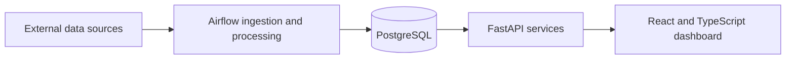

# AlphaPulse — Financial Data & Analytics Application

A personal software project connecting financial data ingestion, backend APIs and an interactive dashboard. Built with **Python, FastAPI, PostgreSQL, React and Airflow**, AlphaPulse explores the application and data workflows behind a financial analytics product.

[Portfolio](https://luichu.dev/) · [Project demo](https://alphapulse.luichu.dev/)

## Engineering highlights

- **Backend and persistence:** FastAPI services, PostgreSQL data storage, SQLAlchemy integration and Pydantic validation.
- **Data workflows:** Airflow DAGs for market-data ingestion, indicator calculation and related processing tasks.
- **Web application:** React and TypeScript components for presenting financial data and analytics.
- **Price data modeling:** Decimal-based price schemas and input validation.
- **Delivery tooling:** Docker configurations, Terraform infrastructure definitions and GitHub Actions workflows.
- **Additional experiments:** model training, experiment tracking and AI integrations are explored alongside the application.

## Application overview



This diagram summarizes the application components; it is not a statement of the current hosted deployment topology.

## Preview


## Project scope and data

AlphaPulse is a **portfolio application**. Some endpoints use mock-data fallbacks when source data is unavailable; displayed demo values should not be treated as verified market observations or investment results.

The repository includes application code, infrastructure configurations, tests and experimental components. Their presence does not establish production readiness, validated model performance or measured cost savings.

## Repository guide

| Path | Contents |
|---|---|
| [src/](src/) | Python application and service code |
| [frontend/](frontend/) | Web application |
| [airflow/](airflow/) | DAGs and processing utilities |
| [training/](training/) | Training and experiment code |
| [infra/](infra/) | Infrastructure and container configuration |
| [tests/](tests/) | Automated test code |

## Local development

The repository provides a Docker-based helper, [local_dev.sh](local_dev.sh). It checks for `docker`, `docker-compose` and `curl`, and uses [infra/docker-compose.yml](infra/docker-compose.yml).

Review [.env.example](.env.example), create a local `.env` and configure the required values before starting:

```bash
cp .env.example .env
# Edit .env for your local environment.
bash local_dev.sh up
bash local_dev.sh status
```

To stop the local stack:

```bash
bash local_dev.sh down
```

## Testing and documentation

- [Testing guide](docs/TESTING.md)
- [Development guide](docs/DEVELOPMENT.md)
- [Quick-start guide](docs/QUICKSTART.md)
- [Python CI workflow](.github/workflows/python-test-and-deploy.yml)
- [Workflow results](https://github.com/ChuLiYu/alphapulse-mlops-platform/actions)

Test availability and results depend on the selected commit, dependencies and configured services. Historical architecture and planning documents may describe goals beyond the current implementation.

**Stack:** Python · FastAPI · PostgreSQL · React · TypeScript · Airflow · Docker · Terraform
