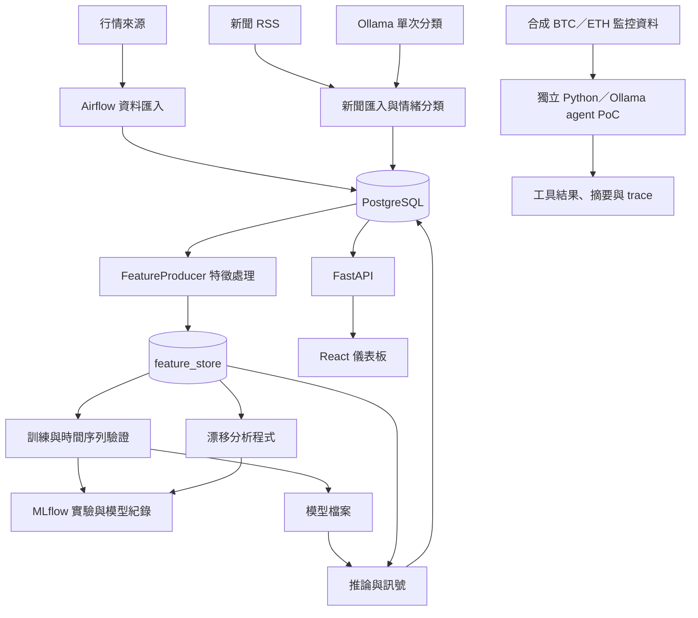

# AlphaPulse 專案導覽與快速複習筆記

更新日期：2026-10-18。用途：快速找回整個專案的脈絡、設計理由、展示方式與面試說法。
本筆記依目前公開 repo 的程式與文件整理；「程式存在」與「本次實測成功」分開記錄。歷史部署、效能與成本數字未重新驗證。

## 1. 先讀這一頁：三分鐘找回全貌

**一句話：AlphaPulse 是以加密貨幣市場為場景，把資料蒐集、特徵處理、模型訓練、推論與展示串起來的 DataOps／MLOps 工程專案，並新增可追蹤的 LLM 工具呼叫 PoC。**

記住五個關鍵字：**資料管線、模型生命週期、金融精度、部署取捨、受控 agent**。

| 問題 | 快速回答 |
| --- | --- |
| 解決什麼問題？ | 把分散的行情、新聞、特徵與模型步驟整理成可維護、可追蹤的流程。 |
| 最大賣點？ | 橫跨資料、後端、ML 與基礎設施，能說明各層怎麼銜接及失敗時怎麼處理。 |
| ML 做什麼？ | 以行情與情緒等特徵建立報酬預測，再轉成訊號；有訓練、驗證及回測程式。 |
| LLM 做什麼？ | 原有新聞情緒分類；新增監控 agent，模型選工具、讀結果、再呼叫下一個工具。 |
| 現在有上線嗎？ | 沒有。託管應用目前離線；agent 已在本機使用真實模型與合成資料驗證。 |
| 目前最強證據？ | 24 項離線測試通過、實際 Ollama traces、來源 commit、模型 digest、安全審查與 PR。 |
| 不能直接證明什麼？ | 投資獲利、正式環境穩定性、任意任務 agent 能力，或完整平台都已驗證。 |

## 2. 整個系統如何連起來

下圖是程式責任的導覽；不是目前所有服務都在線的聲明。Agent 是獨立 PoC，尚未接入真實資料庫或漂移監控服務。



主要流程記成：**收資料 → 做特徵 → 訓練驗證 → 保存模型 → 推論 → 觀察結果**。
Airflow 負責預先定義的排程及依賴；LLM agent 的工具呼叫則由模型產生，兩者的控制方式不同。

## 3. 各層負責什麼，回頭去哪裡看

| 層次 | 職責與程式入口 | 複習重點 |
| --- | --- | --- |
| 資料匯入 | [Airflow DAGs](../airflow/dags/)、[工具模組](../airflow/plugins/alphapulse_utils/) | 行情、RSS、技術指標與資料寫入；先看各 DAG，再看共用函式。 |
| 特徵工程 | [feature_producer.py](../src/alphapulse/ml/features/feature_producer.py)、[feature_integrator.py](../airflow/plugins/alphapulse_utils/feature_integrator.py) | 報酬、波動、均線距離、RSI、成交量、情緒與時間特徵；結果存入 feature_store。 |
| 訓練 | [iterative_trainer.py](../src/alphapulse/ml/training/iterative_trainer.py) | CatBoost 等模型候選、TimeSeriesSplit、Optuna、MLflow 紀錄與模型註冊路徑。 |
| 過擬合檢查 | [overfitting_prevention.py](../src/alphapulse/ml/training/overfitting_prevention.py) | 訓練／驗證差距、學習曲線與特徵重要度穩定性等檢查。 |
| 回測 | [backtest.py](../src/alphapulse/ml/backtest.py) | 交易成本、資金模擬、報酬、Sharpe、最大回撤與勝率；不等於真實交易績效。 |
| 推論 | [engine.py](../src/alphapulse/ml/inference/engine.py) | 讀 feature_store，載入模型，產生 Champion／Challenger 訊號並寫入資料庫。 |
| 監控 | [monitoring](../src/alphapulse/monitoring/) | 漂移與模型表現分析程式；與前端示範指標要分開理解。 |
| 後端 | [main.py](../src/alphapulse/main.py)、[API routes](../src/alphapulse/api/routes/) | 行情、訊號、模型／流程畫面所需 API；含身分驗證與權限邊界。 |
| 前端 | [frontend/src](../frontend/src/)、[useDashboardData.ts](../frontend/src/hooks/useDashboardData.ts) | React／TypeScript 儀表板；有 demo／mock fallback，畫面有值不代表後端健康。 |
| 基礎設施 | [Compose](../infra/docker-compose.yml)、[k3s](../infra/k3s/base/)、[Terraform](../infra/terraform/) | 服務拆分、儲存、部署與雲端資源定義；不要把設定檔視為部署成功證據。 |
| 工程品質 | [tests](../tests/)、[workflows](../.github/workflows/) | 測試涵蓋面、CI 執行結果及尚未執行的檢查。 |
| 新增 agent | [agents](../src/alphapulse/agents/)、[操作指南](agents/README.md) | 工具協定、多輪狀態、限制、證據保存及本機啟動。 |

## 4. 專案值得強調的設計與取捨

### A. 把模型放進完整工程流程

亮點是資料、訓練、模型檔案、API 與展示之間的銜接。Airflow 的 [full_production_dag.py](../airflow/dags/full_production_dag.py) 表達匯入、整合、訓練、漂移分析與推論的依賴。

面試可說：「我關注模型前後的工程問題，包括資料從哪來、怎麼重跑、模型怎麼保存，以及推論使用哪些特徵。」
但 DAG 中呼叫訓練 HTTP endpoint，不自動代表已確認非同步訓練完成；整條流程仍需整合驗證。

### B. 特徵一致性與時間序列觀念

FeatureProducer 用 `feat_` 區分輸入特徵，`metadata_` 保存輔助資料，`target_return` 是下一期報酬標籤。共用的 feature_store 有助於減少訓練與推論各自計算特徵的分歧。

面試可說：「我用時間順序切分與共用特徵處理來降低不合理的驗證結果。」
不要說「完全消除資料洩漏」：新聞可用時間、補值、資料切分、特徵選取及模型版本的一致性，仍需逐項驗證。

### C. 金融精度有明確使用位置

[資料模型](../src/alphapulse/api/models.py) 與回測中的資金／成本採用 Numeric／Decimal；ML 特徵與部分統計計算仍使用浮點數。

面試可說：「金額與交易成本計算注意十進位精度；模型計算則使用數值套件需要的浮點格式。」
不要說「整個專案所有金融計算都沒有浮點數」。

### D. 模型生命週期與監控

有 MLflow 實驗／模型註冊程式，也有 Champion／Challenger 推論與漂移分析程式。
注意：目前 inference engine 主要從本機模型檔案載入；不能因為 import MLflow 或函式名稱提到 Registry，就說推論一定從 Registry 取模型。

面試可說：「專案包含模型比較、紀錄與影子訊號的設計；我能指出哪些已實作，哪些還需要端到端驗證。」

### E. 成本與維運取捨

Repo 留有 AWS 元件、OCI Terraform 與單節點 k3s 設定，適合討論資源受限環境、服務拆分與成本考量。
目前 Terraform prod 是 OCI；舊 README 宣稱的 AWS／GCP 單一變數切換，不能直接當成已完成能力。
歷史 `$11 → $0`、記憶體減半等數字，本次沒有帳單或基準重測，面試前需找回原始紀錄才引用。
單節點降低複雜度，但有單點故障，也需要備份／復原與安全設定；不是高可用架構。

## 5. LLM 與 agent：這次新增的核心能力

### 原本有什麼

[SentimentAnalyzer](../airflow/plugins/alphapulse_utils/sentiment_analyzer.py) 呼叫 Ollama 做新聞情緒分類，再由排程保存分數。這是 LLM 整合，但每次分類是單次呼叫。
`signals.py` 的部分 `llm_summary` 是寫死的示範文字；套件列表有 LangChain／Groq，也不能直接證明有 agent。

### 現在增加什麼

使用 Python 標準函式庫與 Ollama 原生 `/api/chat` 工具呼叫，沒有使用 LangGraph。

```text
使用者提出監控任務
  → 模型產生 get_snapshot 工具呼叫
  → Python 驗證參數並回傳合成 snapshot 與 ID
  → 模型讀取結果，產生 evaluate_snapshot(ID) 呼叫
  → Python 驗證 ID 來自先前回合，計算門檻評估
  → 模型根據工具結果產生摘要
```

**模型負責選工具與解釋；程式負責授權、驗證與確定性的比較。**
兩個工具有資料依賴，符合展示 tool-calling 與 multi-step chaining 的需要。
這是受限任務：資料集、工具與門檻由程式定義；不是能處理任意問題的通用自主 agent。

安全邊界包括：工具白名單、嚴格參數與符號範圍、跨回合 snapshot ID、最多 6 回合／8 次工具呼叫、請求與回應大小限制、只允許 loopback HTTP、停用代理與轉址，以及私有權限、不可覆寫的 trace 檔案。
不允許任意 shell、SQL、遠端 URL 或交易操作。限制是程式強制執行，不能只靠 prompt。

### 真實驗證證據

| 驗證 | 已知結果與範圍 |
| --- | --- |
| 離線測試 | 13 項 agent 協定測試 + 11 項安全回歸測試通過；另 1 項 opt-in live unittest 預設略過。 |
| 原版真實模型執行 | commit `2593bd6`，BTC／ETH 各 3 次，6/6 完成。 |
| 安全修正版真實執行 | commit `f06ef0a`，BTC／ETH 各 1 次，2/2 完成。 |
| 模型與證據 | Ollama 0.40.6、qwen3:4b；trace 保存模型工具呼叫，metadata 記錄版本、digest 與來源 commit。 |
| 結果核對 | 人工比對摘要與工具結果；runtime 的 completed 不代表自動驗證自然語言完全正確。 |
| CI | 獨立 agent／security workflow 通過；完整平台 workflow 安裝依賴失敗，未執行完整測試。 |

完整說明：[EVIDENCE.md](agents/EVIDENCE.md)。已去除個人路徑的實測紀錄：[original](../examples/agent/live/original/)、[hardened](../examples/agent/live/hardened/)。
八次執行分屬兩個版本，不能合併宣稱安全修正版通過八次，也不能推論一般可靠度。

## 6. 安全修正也是工程故事的一部分

這次針對 API／agent 邊界檢查並修正：

- JWT signing key 必須明確設定，驗證 token 類型、期限與有效使用者；移除預設管理員帳密。
- API key 改存摘要，提供既有明文 key 遷移工具；限制 key scope 並重新檢查擁有者目前的權限。
- 行情、指標、訊號路由區分讀／寫授權，避免匿名注入資料。
- 收斂 CORS、Compose 對外連接埠與服務預設密碼設定。
- 情緒分類結果採嚴格結構與數值驗證，限制模型服務位址、轉址與回應大小。
- 請專門安全代理複查上述修正；複查未再發現範圍內的重大問題。

這不等於全 repo 安全認證。Refresh token 撤銷／防重放仍是部署前待辦，完整歷史、相依套件、所有路由、Terraform／k3s 與主機設定也未完成全面審查。遷移與操作步驟見 [SECURITY_REVIEW.md](agents/SECURITY_REVIEW.md)。

## 7. 用證據區分目前狀態

| 狀態 | 可以怎麼理解 |
| --- | --- |
| 本次實際驗證 | 本機 Ollama agent、指定合成資料、24 項離線測試及限定安全複查。 |
| 原碼有實作，本次未重跑全流程 | 行情／新聞 DAG、特徵工程、訓練、回測、推論、漂移分析及完整資料庫整合。 |
| 示範／mock | 前端資料 fallback；ops API 的部分流程狀態、模型列表與漂移值；部分 llm_summary。 |
| 歷史／設計 | 雲端部署圖、成本與效能敘述、部分 ADR；需要獨立操作紀錄才能證明實際部署成果。 |
| 尚待處理 | 全平台依賴衝突、refresh token 防重放／撤銷、全面部署安全與整合驗證。 |

完整平台目前的依賴衝突：`pandas<2.2` 需要 NumPy<2，但當時可取得的 `pandas-ta` 版本需要 NumPy>=2.2.6。獨立 agent CLI 使用標準函式庫，已分開驗證；不要直接升級整套 ML 相依套件後假設相容。

舊 README 的 Production-Grade、Stable、Live Demo、100% type-hinted 等字樣不應直接當作當前證據；部分連結與啟動帳密說明也有歷史落差。啟動 API／infra 前以安全升級文件為準。本筆記是導覽，沒有取代完整架構或安全稽核。

## 8. 面試如何介紹

### 30 秒：先講問題，再講工程價值

> AlphaPulse 是我用金融市場資料練習完整資料與模型生命週期的專案。它涵蓋 Airflow 資料管線、特徵處理、模型訓練、FastAPI 與儀表板。我最近也加入了 Python／Ollama 多步驟工具呼叫 agent，讓模型先取得監控資料，再呼叫評估工具產生摘要。我最想展示的是各層如何銜接、如何留下證據，以及如何限制模型權限。

### 90 秒：補一個具體例子與限制

> 原本專案的 LLM 功能是新聞情緒分類，屬於單次呼叫。為了展示工具使用，我加入兩個有依賴的工具：模型先取得 snapshot，再使用回傳的 ID 呼叫評估工具。數值門檻由 Python 計算，模型負責選工具與摘要。我用真實 Ollama 執行並保存 trace，也針對工具參數、連線與 API 權限補上測試。目前是合成資料的本機 PoC，尚未部署；完整平台仍有依賴及安全待辦。

### 英文版本

> AlphaPulse is a financial-market data and MLOps project covering ingestion, feature engineering, training, inference, and a dashboard. I extended it with a bounded Python and Ollama agent that performs dependent tool calls: it retrieves a monitoring snapshot, uses the returned ID to request an evaluation, and summarizes the results. Numerical checks run in Python, while the model selects tools and explains results. I focused on validation, execution limits, security boundaries, and observable traces. The agent has recorded live-model runs using synthetic data; it is a local proof of concept, not a deployed production service.

以上是依專案能力組織的說法；使用「我」介紹時，要依自己的實際參與調整。AI 協作開發要如實說明，尤其要能解釋自己理解、驗證與負責的部分。

### 常見追問速答

| 追問 | 回答重點 |
| --- | --- |
| 為什麼算 agent？ | 有模型產生的工具呼叫、工具結果回饋，以及依賴前一步結果的下一次呼叫。 |
| 是否硬寫流程？ | 任務、工具及合法操作受到限制；呼叫由模型產生，程式驗證順序和資料依賴。尚未證明通用規劃能力。 |
| 為什麼不直接寫 Python？ | 固定門檻比較本來就應由 Python 做；這個 PoC 用來驗證 LLM 如何透過受控工具完成多步驟任務，不宣稱比固定流程更有效率。 |
| 為什麼不用 LangGraph？ | 兩個工具的受限任務可以先用原生協定完成，容易理解與測試；若日後需要持久化狀態、恢復或複雜分支，再評估框架。 |
| 為什麼用合成資料？ | 能固定輸入、驗證依賴與錯誤處理，避免把真實資料存取混進初期 PoC；下一階段才接唯讀真實資料與授權。 |
| 可以接到驗證業務嗎？ | 可遷移的是受控工具、輸入驗證、可追蹤紀錄與分步處理的工程方法；目前沒有實作身分驗證或 KYC 業務。 |
| 模型摘要錯了怎麼辦？ | 目前人工比對；下一步可加入結構化最終輸出與自動一致性檢查。不能把完成狀態當正確性保證。 |
| 最有挑戰的地方？ | 從自己實際解決且能展示 diff／trace 的問題選一個，例如工具依賴、API key scope 越權，或模型連線限制。 |

### 要強調／避免講的話

- 強調：工程流程、具體取捨、程式強制的安全限制、實測與可追溯證據。
- 避免：production-ready、所有 CI 都綠、完全安全、完全防止資料洩漏、即時交易、保證獲利、通用自主 agent。
- 沒有證據先不引用：節省成本比例、記憶體減少百分比、雲端一鍵切換、模型準確率或收益。
- 不把安裝的套件說成已用到的能力，也不把本次安全檢查範圍說成全平台認證。

## 9. 面試前十分鐘如何複習與展示

1. 先看第 1 節，講一次 30 秒介紹。
2. 看第 2 節，說出資料如何走到模型與 API。
3. 開一份 [BTC trace](../examples/agent/live/hardened/btcusdt-1.json)，指出兩次工具呼叫、snapshot ID 與最後摘要。
4. 說明一個程式強制的安全限制，再指出測試位置。
5. 最後記住三個限制：合成資料、本機 PoC、全平台未完成驗證。

在 repo 根目錄，先確認 Python 3.12+、Ollama 已啟動且有 `qwen3:4b`：

```bash
curl -fsS http://127.0.0.1:11434/api/version
PYTHONPATH=src python3 -m unittest discover -s tests/agent_poc -v
PYTHONPATH=src python3 -m alphapulse.agents.monitor --mode ollama \
  --model qwen3:4b --symbol BTCUSDT --include-trace
```

若服務未啟動：在另一個終端執行 `OLLAMA_HOST=127.0.0.1:11434 ollama serve`，首次使用再下載 `ollama pull qwen3:4b`。
若模型放在自訂目錄，啟動時需設定相同的 `OLLAMA_MODELS`；不要為面試臨時重下載或切換模型版本。
本機本次每個任務約兩分鐘，展示時預留時間；`--mode replay` 是 scripted 協定示範，不能假裝成真實 LLM 執行。
完整輸出保存方式與限制見 [agent 操作指南](agents/README.md)。

## 10. 下一階段，怎麼把專案往前推

優先順序：修正全平台依賴並重跑整合測試 → 補齊部署安全與 token 撤銷 → agent 接唯讀真實監控資料並保留授權 → 自動驗證摘要與擴充失敗情境評估 → 再評估部署。
後續若要提高 agent 能力，應先定義新任務、成功標準與權限範圍，再增加工具；不要只堆框架。

延伸閱讀：[LLM 證據盤點](agents/EVIDENCE.md)、[安全審查與升級](agents/SECURITY_REVIEW.md)、[架構決策索引](architecture/README.md)、[Draft PR #3](https://github.com/ChuLiYu/alphapulse-mlops-platform/pull/3)。
