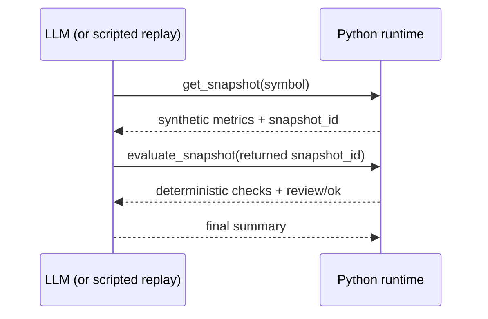

# AlphaPulse monitoring agent PoC

A small Python agent for investigating monitoring signals with two dependent,
read-only tools. The live backend uses Ollama's native `/api/chat` tool-calling
protocol. No LangGraph dependency is needed for this bounded loop.

## What it demonstrates



The runtime does not force the model to emit predetermined tool calls. In live
mode the model chooses actions from tool schemas. A final answer is accepted
only after a successful evaluation of a snapshot retrieved on an earlier model
turn. Calling both tools in one batch is insufficient. A model that fails to
follow the protocol returns `incomplete`, never a fabricated success.

`get_snapshot` returns one of two explicitly synthetic fixtures. The second tool
uses server-held data, so the model cannot invent the metric values or thresholds
passed to the evaluator. BTC triggers three breaches; ETH has none. Thresholds
are illustrative monitoring policy, not calibrated financial risk rules.

## Run without services

Python 3.12+; run from the repository root. No pip install, database, Airflow, or
production environment is required.

```bash
PYTHONPATH=src python -m unittest discover -s tests/agent_poc -v
PYTHONPATH=src python -m alphapulse.agents.monitor --mode replay \
  --output /tmp/alphapulse-replay-new.json
PYTHONPATH=src python -m alphapulse.agents.monitor --mode replay --symbol ETHUSDT
```

Replay uses a scripted test double. Its trace demonstrates the runtime's protocol
and deterministic tools, **not actual LLM tool selection or model quality**.

## Run with a real model

Install and start [Ollama](https://docs.ollama.com/quickstart) separately. Use a
model supporting [tool calling](https://docs.ollama.com/capabilities/tool-calling).
For example, on a machine with enough RAM/disk for the model:

```bash
ollama pull qwen3:4b
# Start `ollama serve` in another terminal if the service is not already running.
PYTHONPATH=src python -m alphapulse.agents.monitor --mode ollama \
  --model qwen3:4b --output /tmp/alphapulse-live-btc.json
ALPHAPULSE_LIVE_AGENT=1 PYTHONPATH=src \
  python -m unittest discover -s tests/agent_poc -v
```

Override `OLLAMA_HOST` or `--host` for a local Ollama endpoint;
`ALPHAPULSE_AGENT_MODEL` selects the model for the opt-in live test. Live model
behavior can differ across model versions; temperature zero is not a guarantee.
An unreachable endpoint returns `incomplete` and exits with status 1.

Record a repeatable evaluation into a **new** output directory, chosen by the
caller rather than embedded in source:

```bash
PYTHONPATH=src python -m alphapulse.agents.evaluate \
  --model qwen3:4b --repetitions 3 \
  --code-commit "$(git rev-parse HEAD)" --output-dir ./agent-runs/run-001
```

The evaluator runs both symbols, preserves failures, writes private files, and
refuses to overwrite a previous run. The selected model digest, Ollama version,
UTC timestamps, and source revision accompany the traces. Inspect each answer
against `evaluations`; workflow completion alone does not prove grounding.
Only sanitized **synthetic fixture** traces belong in the public repository.
Run directories are ignored by Git. See [recorded results](EVIDENCE.md).

This CLI runs on the host with Ollama bound to loopback. Accepted endpoints are
HTTP localhost or literal loopback addresses (IPv4/IPv6), without credentials,
paths, query strings, or fragments. Proxy forwarding and redirects are disabled;
responses are capped at 1 MiB. Remote servers and the Docker-internal hostname
`ollama` are deliberately unsupported by this host CLI. The separate Airflow
integration separately allows only loopback or the exact Docker service `ollama`,
with redirects/proxies disabled and bounded streamed responses.

Live stdout omits the tool trace unless `--include-trace` is set. `--output` is an
explicit request to persist the full fixture trace in a new 0600 file. The batch
evaluator also persists traces explicitly via `--output-dir`, with a 0700 run
directory. Files publish atomically without replacement. Do not connect customer
data to these tools without adding a data minimization/redaction policy.

## Bounds and evaluation

- Six model turns, eight tool calls, 120-second request timeout, and 1,024 output
  tokens per model request. No retries or recursive tool execution.
- Allowlist dispatch, exact argument shape, symbol scope, and prior-turn snapshot
  dependency checks. Unknown tools and malformed arguments return structured
  errors to the model so it may recover within budget.
- The trace records tool arguments, outputs, and turns; it does not store model
  thinking. Deterministic `evaluations` are separate from free-text `answer`.
- Thirteen offline tests cover the dependent chain, healthy/breached data, unknown
  tools, malformed calls, invented IDs, cross-symbol requests, early/empty final
  responses, budgets, provider failure, HTTP payload shape, endpoint restrictions, artifact safety, and evaluator failures. One opt-in test
  exercises the real Ollama chain. CI runs offline tests and replay only.

The PoC has no trading, database write, shell, arbitrary file access, retrieval
from the web, or deployment tools. It is not wired to production metrics, the
existing Airflow DAG, or the frontend. Free-text summaries can still hallucinate;
the completion gate checks workflow execution, not semantic correctness. Prompt
injection resistance on external data, load testing, persistent state, and
production authorization are outside this fixture-based PoC.
